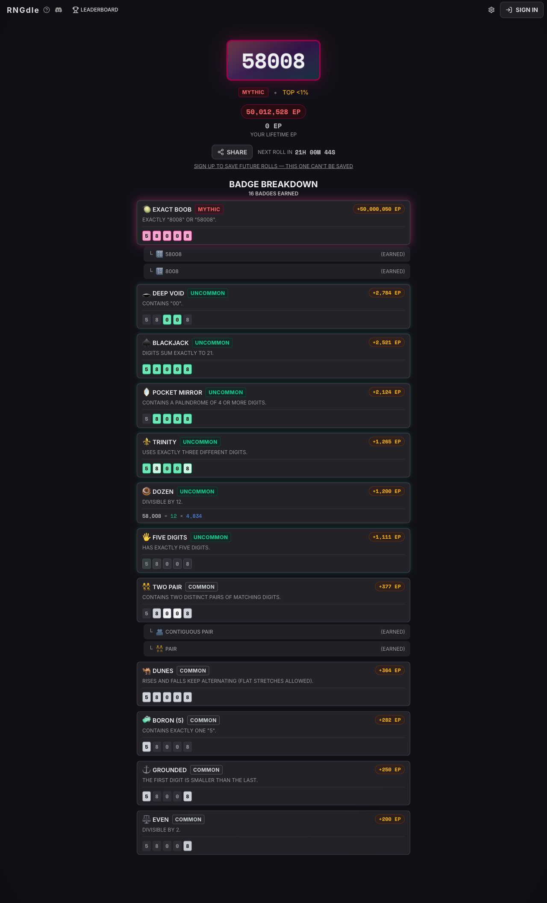
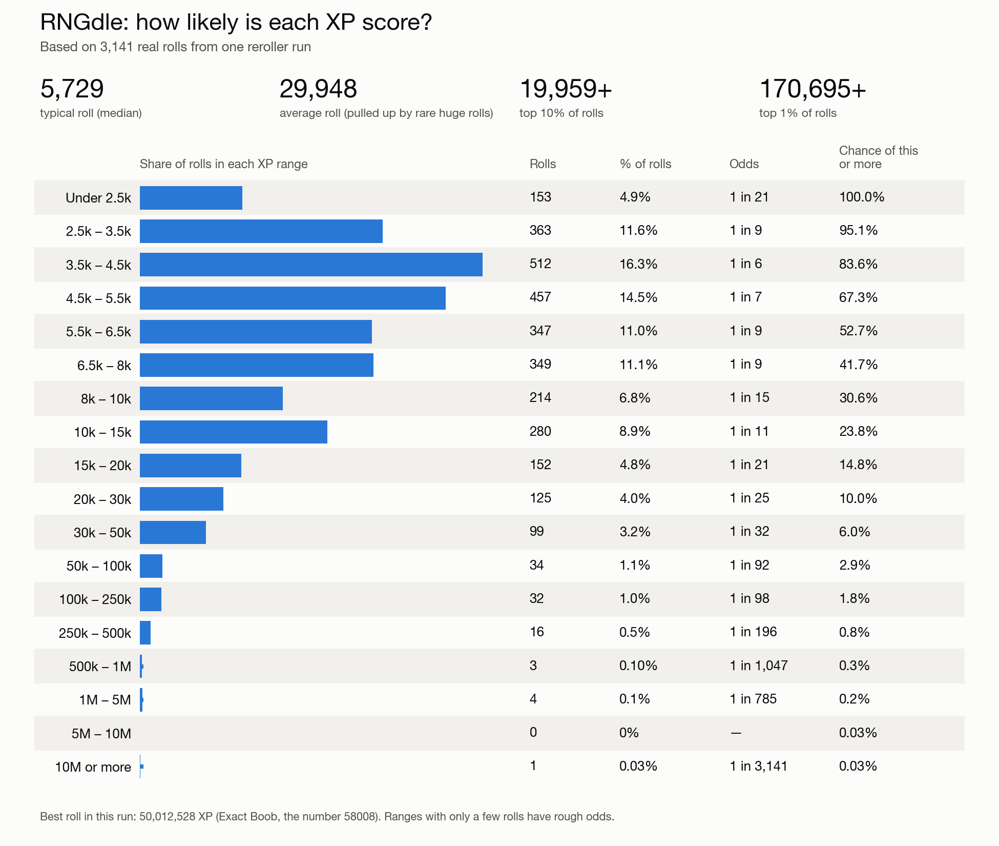
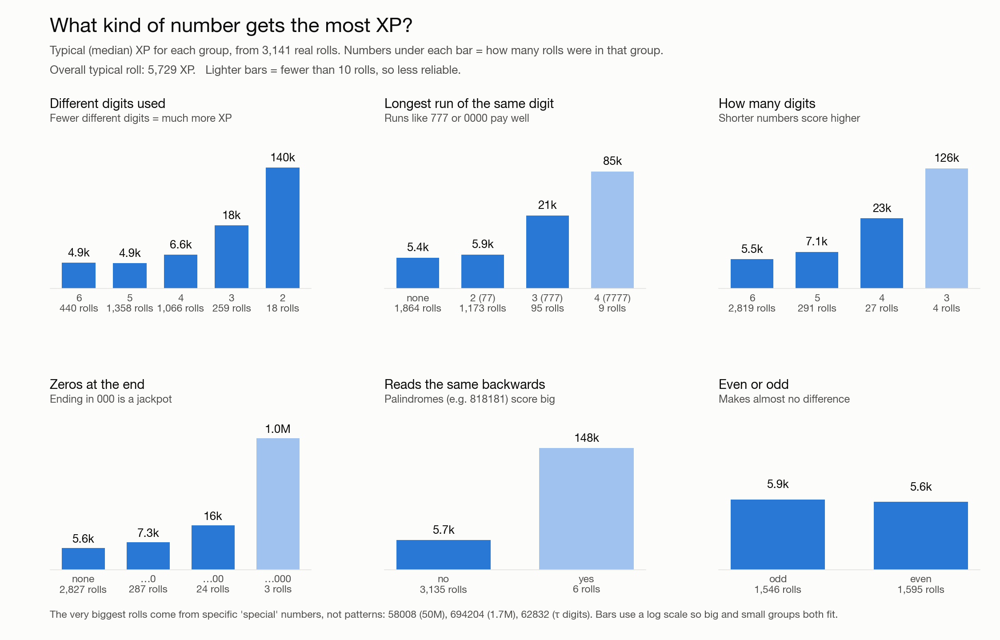

# RNGdle Reroller

A fast, parallel reroller for [RNGdle](https://www.rngdle.com), the one-roll-a-day number game, plus a statistical look at what the rolls are worth.

Built for a friendly "who can write the fastest and best code" competition.

| Best roll: **58008**, 50,012,528 XP | Runner-up: **662831**, 5,002,060 XP |
|---|---|
|  |  |

## How it works

RNGdle guest rolls live entirely in the browser's `localStorage`. Each attempt:

1. clears local and session storage, so the site sees a fresh visitor,
2. reloads the page and clicks the site's own **Generate a new number** button,
3. reads the stored result (`number`, `badges`, `totalScore`) back out.

Every roll is a real roll made through the site's UI. Nothing is forged or edited. Several browser contexts run in parallel, each with its own isolated storage, which reaches about **7–8 rolls per second** headless with 4 tabs.

When a roll beats `--target`, the script stops every other tab, waits for the reveal animation to finish, and saves a full-page screenshot. It leaves the winning window open and untouched.

## Setup

```bash
python3 -m venv .venv
.venv/bin/pip install -r requirements.txt
.venv/bin/playwright install chromium
```

## Usage

```bash
.venv/bin/python reroll.py                          # roll until Ctrl+C
.venv/bin/python reroll.py -n 200 -w 4              # 200 rolls across 4 parallel tabs
.venv/bin/python reroll.py -w 6 --headed            # watch the browser windows
.venv/bin/python reroll.py --headed --watch 3       # hold each result for 3 s
.venv/bin/python reroll.py -w 6 --headed --target 10000000 --log rolls.csv
```

| Flag | What it does |
|---|---|
| `-n N` | total rolls (0 = until Ctrl+C) |
| `-w N` | parallel tabs (default 2) |
| `--headed` | show the browser windows |
| `--watch [S]` | pause S seconds on each revealed result (default 3) |
| `--target XP` | stop at the first roll above this XP and take a full-page screenshot |
| `--log FILE` | append every roll to a CSV (`roll,number,xp`) |
| `--shot FILE` | screenshot of the best roll so far (default `best.png`, `''` to skip) |
| `--light` | use the site's light theme (dark is the default) |

## Results

- **First run:** stopped at the first roll over 1.5M XP. It hit **662831** (Tau Slice, 5,002,060 XP) on roll #965.
- **Second run:** stopped at the first roll over 10M XP. It hit **58008** (Exact Boob, 50,012,528 XP) on roll #3,136. Every roll was logged, and the charts below use these **3,141 rolls**.

### How likely is each XP score?



The typical roll is about **5,700 XP**. The average is pulled up to about **30,000 XP** by rare huge rolls. One roll in 10 beats about 20,000 XP, and one in 100 beats about 170,000 XP.

### What kind of number gets the most XP?



The more patterned a number is, the more XP it earns. These figures are median XP. A normal roll is about 5.7k.

| Trait | Typical XP |
|---|---|
| Only 2 different digits | 140k |
| Palindrome | 148k |
| 3-digit number | 126k |
| Run of 4 identical digits | 85k |
| Ends in 000 | 1.0M (only 3 rolls) |
| Even vs odd | 5.9k vs 5.6k, no real difference |

The very biggest jackpots come from specific "special" numbers rather than general patterns: 58008, 694204 and the digits of τ (62831…).

Regenerate the charts with:

```bash
.venv/bin/python plot_xp.py
.venv/bin/python plot_traits.py
```

## Files

| Path | Contents |
|---|---|
| `reroll.py` | the reroller |
| `plot_xp.py` | XP odds chart |
| `plot_traits.py` | number-type vs XP chart |
| `data/run2_rolls.csv` | 3,141 logged rolls (`roll,number,xp`) |
| `charts/` | rendered charts |
| `screenshots/` | full-page screenshots of the two target hits |

## A note on fair play

These are guest rolls. They stay in the browser and never reach the site's leaderboard or anyone's account. Please keep it that way, and keep the tab count modest so you don't hammer the site.
